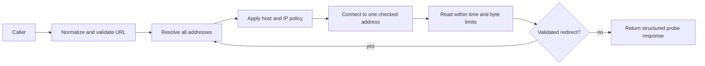

# Architecture

## Layers

- `domain`: stable, transport-independent data models and typed errors.
- `application`: request/result contracts, shared use-case boundary, and provider ports.
- `config`: immutable configuration model, safe defaults, and source/loader boundaries.
- `infrastructure/http`: URL normalization, DNS/address policy, pinned HTTP/HTTPS requests,
  redirect handling, and probe metadata collection.
- `application/evidence`: deterministic passive evidence extraction from the Phase 2 response.
- `application/fingerprinting`: pure evidence-to-detection scoring engine.
- `fingerprinting/definitions.ts`: versioned, data-only technology signatures, independently
  extensible from the engine.
- `application/versioning`: version assessment, reconciliation, comparison, and range evaluation.
- `application/versioning/strategies.ts`: ecosystem strategy registry and built-in version parsers;
  strategy rules remain separate from the generic assessment engine.
- `infrastructure/intelligence`: external advisory providers and provider-specific adapters.
- Other infrastructure adapters: cache, configuration-source,
  and transport implementations.
- `application/scan`: shared orchestration service composing the existing Phase 2–10 services.
- `api`: framework-light Node HTTP adapter with bounded request handling.
- `cli`: thin command-line adapter for help, version, and scan output.

CLI and HTTP API adapters call the same `ScanApplicationService`; transports do not own probe or
identification logic. `HttpProbeProvider` implements the existing `HttpProvider` port and remains
the sole target-request path. The Phase 1 `IdentificationService` contract remains intact.

## Dependency direction

Adapters depend on application contracts. Application code depends on domain models and ports.
Domain depends on no outer layer. Infrastructure implements ports and is composed at the
application entry point. The HTTP provider receives immutable configuration and a resolver; it
does not read process environment. Network access occurs only through an explicit provider call.

## Phase 2 probe flow

The resolver checks every DNS answer, and each socket is pinned to a checked address. Redirect
destinations pass the same policy before a request. The structured response contains normalized
headers, separate Set-Cookie values, content metadata, HTTPS certificate metadata, final URL,
redirect chain, resolved/remote addresses, and request timing. It can feed a future Evidence
Engine but does not identify technologies.

## Phase 3 Evidence Engine

`EvidenceEngine.collect(HttpResponse)` is synchronous and has no network/provider dependencies.
It emits an ordered, versioned `EvidenceCollection`; stable evidence `type` and `source` values
describe where an observation came from. Direct probe fields and derived HTML/body observations
remain distinct, and conflicting values are preserved. The engine does not assign technology
hints, merge observations, or make technology/vulnerability verdicts.

It collects response headers and cookies; generic HTML metadata, generator values and titles;
script, stylesheet and asset references; generic content structure markers; redirects; TLS,
address and timing observations; and response status/content metadata. It does not execute or load
discovered resources. Relative URL references resolve against the normalized final URL. Query,
fragment and userinfo components are removed from evidence URLs. Cookie values/attributes,
sensitive headers, and token-bearing meta values are redacted.

The default body inspection cap is 512 KiB and may be raised to 2 MiB. Evidence output defaults
to 512 items and may be raised to 4,096. Raw values are bounded to 512 characters, normalized
values to 512 characters (2,048 for URLs), and the collection reports byte and item truncation.
Generic `versionHint` values are unverified candidates; `strength` describes source fidelity only.
The JSON schema is `schemas/evidence-collection.schema.json`.

## Phase 4 Technology Fingerprint Engine

`FingerprintEngine.fingerprint(EvidenceCollection)` is synchronous, deterministic, and network-free.
It accepts Evidence Collection schema `1.0` and returns `FingerprintResult` schema `1.0` with the
input schema version, ordered `TechnologyDetection` values, and evidence references. Its only inputs
are evidence and a validated `FingerprintDefinitionSet`; it has no HTTP, CLI, API-controller,
intelligence, cache, or remediation dependencies.

Engine logic lives in `src/application/fingerprinting`; signatures live independently in
`src/fingerprinting/definitions.ts`. The versioned data pack uses only literal `equals`, `contains`,
and `prefix` matching and is validated at construction. Adding signatures for another technology
normally means adding a definition and tests, without changing core scoring. JSON schemas cover both
definition sets and result output.

Initial definitions identify PHP, nginx, and Apache from explicit or indirect evidence such as
headers, PHP session cookie names, and generator metadata. The engine preserves independent matched
evidence refs and all matching version candidates. Repeated hits for one rule do not increase the
score. Independent rule weights combine using noisy-OR (`1 - product(1 - weight)`); confidence is
rounded to three decimals and a lone signal is capped. For definitions that declare contradictions,
contradiction support reduces the score by a 65% penalty factor. These values are heuristics, not
calibrated probabilities. Header and generator reasons flag spoofing, proxy/CDN, or self-report
limitations.

Detection confidence describes technology evidence; version confidence describes the evidence for
one version candidate. A candidate is emitted only when the Phase 3 generic version hint occurs
adjacent to that same rule's technology token in the same evidence item. Missing, unrelated, or
conflicting evidence does not produce an invented version. All candidates, including competing
versions, remain in `versionCandidates`; the top candidate is selected by confidence then lexical
value. Contradictory evidence is separately retained with technology and signal provenance.

The engine does not verify versions, download remote rules, generate rules with AI, make CVE or
vulnerability claims, or provide remediation. Unknown technologies remain undetected. See
[`docs/fingerprinting.md`](docs/fingerprinting.md) for the confidence model and rule extension steps.

## Phase 5 Version Intelligence Engine

`VersionIntelligenceEngine.assess(FingerprintResult)` consumes fingerprint result schema `1.0` and
returns `VersionAssessmentCollection` schema `1.0`. It also exposes strategy-routed comparison and
range evaluation. The engine is synchronous and has no network or provider dependencies.

The generic assessment engine depends on `VersionStrategyRegistry`, whose strategies parse and
compare formats independently. The built-in registry provides generic SemVer and PHP, nginx, and
Apache profiles. New ecosystems can register a strategy without adding product branches to the
assessment engine. Unknown technology IDs use strict generic SemVer only.

Assessments keep original observed candidate strings and Phase 4 evidence refs separate from parsed
upstream versions and vendor/distribution package versions. Candidate statuses include parsed,
incomplete, ambiguous, malformed, unsupported, and unknown. All candidates are preserved; a selected
upstream version is returned only when all candidates parse and reconcile to one normalized value.
SemVer prerelease precedence is supported, and build metadata is retained but ignored for ordering.

Recognized Debian/Ubuntu/Fedora/RHEL-family package revisions are split into an upstream component
and a separately retained vendor package record. Unknown suffixes are not stripped. Upstream range
evaluation returns `unknown` for distro package versions rather than assuming a vendor backport is
absent. Range inputs support inclusive `introduced`, exclusive `fixed`, inclusive `lastAffected`,
and conjunctive comparison constraints. Range membership is mechanical and is not a security result.
The stable payload schemas are `schemas/version-assessment.schema.json` and
`schemas/version-range.schema.json`; the evaluator response is described by
`schemas/version-range-evaluation.schema.json`.

These contracts support later range correlation and vendor-specific evaluation; Phase 5 itself
does not query advisories or decide affected/fixed status. See
[`docs/versioning.md`](docs/versioning.md) for parsing limits and strategy extension instructions.

## Phase 6 OSV Intelligence Integration

`IntelligenceResolverService` is an application service called by the shared scan workflow.
It accepts normalized package/version queries or Phase 5 assessments, chooses a registered
`AdvisoryIntelligenceProvider`, and uses the existing `CacheProvider`. Package identity comes only
from explicit `TechnologyPackageMapping` entries. There are no built-in PHP, nginx, or Apache
mappings because a technology label does not identify a canonical package across distributions.
Unknown, conflicting, or vendor package versions are not sent as upstream versions.

`OsvIntelligenceProvider` calls the official OSV query, batch-query, and ID lookup endpoints.
The batch adapter hydrates returned identifiers to full records and preserves partial failures.
`osv-adapter.ts` is the only module that understands OSV's wire response shape; it emits
`NormalizedAdvisory`. The domain model retains package ecosystems, event ranges, explicit affected
versions, fixed event boundaries, severity, references, timestamps, withdrawal and provenance.
Ranges remain source data; no version correlation or security verdict is applied.

Requests have bounded timeout, retries, page count, batch size, returned advisory count and response
bytes. HTTP errors, malformed JSON/schema, exhausted retries, and invalid records are typed provider
failures and are not cached as empty results. HTTP 429/503 honors a capped `Retry-After`. Cache keys
include result schema, provider, ecosystem, package and exact version; TTL defaults to 300 seconds.
Cached normalized results retain retrieval/source modification times. See
[`docs/intelligence.md`](docs/intelligence.md) for behavior and limitations.

## Phase 7 NVD and vendor sources

`NvdIntelligenceProvider` uses NVD CVE API 2.0 ID queries and explicitly bounded modified-date
windows. `nvd-adapter.ts` owns NVD wire parsing, including CVSS metrics, CWE identifiers, CVE status,
references, and recursive CPE configuration trees. Optional API credentials enter through the
configuration boundary and remain in the request header. NVD does not infer CPEs from technology
names. Canonical Ubuntu records and Red Hat CVE records are retrieved through fixed official
machine-readable endpoints; `vendor-providers.ts` keeps those formats out of the domain contract.
PHP advisory HTML is not scraped because a stable public machine interface is unavailable.

The application resolver exposes multi-source ID and package-query methods. It invokes registered
providers independently, isolates failures, caches only complete normalized records per provider,
and emits `MultiSourceIntelligenceResult`. Cross-source duplicate IDs and aliases are intentionally
not merged: each source retains its authority, retrieval/source modification times, affected ranges,
severity, CPEs, and vendor package/patch notes. `NO_RESULTS` means queried sources returned no record;
provider failure and unsupported operations have separate statuses and do not imply safety. This
layer retrieves data only and performs no vulnerability correlation or adjudication.

## Phase 8 Vulnerability Correlation

`VulnerabilityCorrelationEngine` consumes typed Phase 4 detections, Phase 5 assessments, and
Phase 6/7 source-separated results. A caller supplies `TechnologyPackageIdentityMapping`; remote
detection labels never imply a package or ecosystem. The mapping declares authority, exact package
identity, a Phase 5 version strategy, supported range encodings, and optional exact CPE identity.
Ambiguous mappings and unresolved versions remain insufficient/unknown evidence.

OSV event streams are converted to Phase 5 `VersionRange` values and evaluated by the existing
`VersionIntelligenceEngine`. `introduced` and `last_affected` are inclusive; `fixed` and `limit`
are exclusive. Range type evaluation requires explicit mapping support. CPE data is used only when
the mapped CPE vendor/product exactly matches; the engine reports NVD matches as potential because
the complete environment boolean expression is not evaluated. Exact vendor patch results require an
authoritative inventory record for installed vendor, distribution, package, and revision plus an
official matching vendor release record. Upstream ranges alone cannot prove a distribution package
is fixed.

Aliases group related source records for a per-advisory result, while original records and all
source-specific ranges, severities, CPEs, fixed versions, vendor patch facts, and provenance remain
separately represented. Source conflict yields `CONFLICTING_EVIDENCE`, except an exact vendor fixed
revision can establish `PATCHED_BY_VENDOR` for that vendor package while retaining upstream conflict
explanations. Rejected/withdrawn records remain visible without active range conclusions. No
confidence aggregate or target-wide security status exists. Contracts and schema are
`src/domain/correlation.ts` and `schemas/correlation-result.schema.json`; see
[`docs/correlation.md`](docs/correlation.md).

## Phase 9 Confidence and Security Assessment

`SecurityAssessmentEngine.assess` is a deterministic application service over Phase 4 detections,
Phase 5 version assessments, Phase 6/7 source-separated intelligence, and Phase 8 correlations.
It does not call transport/providers or alter earlier results. The caller supplies explicit Phase 8
package mappings and an `assessedAt` instant, which makes staleness evaluation reproducible.

Output includes target, per-technology, and per-advisory states. It preserves the complete Phase 8
correlation on every advisory assessment, including original source records, conflicts, ranges,
severity and provenance. Detection confidence, version confidence, package identity, vulnerability
applicability, advisory authority, requested-source completeness, independent corroboration and
contradiction penalty are separate score dimensions. Duplicate evidence references and duplicate advisory records do not add
weight; corroboration requires caller-verified distinct source lineage groups and distinct advisory
payloads. Scores are
heuristics, not probabilities.

`CONFIRMED_VULNERABLE` requires Phase 8 `AFFECTED`, reliable detection and a single parsed/reconciled
version, an exact explicit mapping, active primary/vendor in-range evidence, complete fresh requested
provider coverage, and the documented aggregate threshold. Potential applicability or any missed
gate remains `LIKELY_VULNERABLE` or a non-positive/unknown state. `PATCHED` needs an evaluated fixed
boundary; `PATCHED_BY_VENDOR` relies on Phase 8's exact installed vendor revision evidence.
`NO_KNOWN_VULNERABILITY` is scoped only to supplied package/version and requested providers; it is
not a security guarantee. Provider completeness, stale/unsupported mappings, and limitations remain
serialized, and an unknown technology is never averaged away by a known result.

The stable input/output schemas are `schemas/security-assessment-input.schema.json` and
`schemas/security-assessment-result.schema.json`. Confidence rules and state precedence are
documented in [`docs/confidence-model.md`](docs/confidence-model.md) and
[`docs/assessment-states.md`](docs/assessment-states.md).

## Phase 10 Remediation Engine

`RemediationEngine.plan` consumes versioned Phase 9 assessments, Phase 8 correlations, Phase 5
version assessments, normalized provider records, explicit package mappings, and optional
caller-verified lifecycle information. It is deterministic and has no transport, CLI, API, network,
or package-manager dependency. Per-technology and per-advisory plans preserve Phase 9 states and
source records; remediation output never changes security verdicts.

An upstream target is emitted only when authoritative active advisory boundaries match Phase 8
package/range evidence and Phase 5 proves the current and candidate versions comparable using the
explicit package strategy. Compatible findings aggregate only under one mapping, version scheme,
and strategy. Conflicts, stale or partial data, unknown status, potential applicability, and
unsupported semantics remain manual review. Vendor revisions and upstream versions are separate;
vendor guidance requires an exact vendor/distribution/package mapping and official release record.
Commands are never synthesized. EOL is reported only from fresh caller-verified lifecycle input.

Stable contract/schema: `src/domain/remediation.ts` and
`schemas/remediation-plan.schema.json`; behavior is documented in [`docs/remediation.md`](docs/remediation.md).

## Result compatibility

The serialized identification result includes `schemaVersion`. Changes must follow
`PROJECT_CONTEXT.md`; transports must not invent parallel result shapes. The Draft 2020-12 JSON
Schema is `schemas/identification-result.schema.json`. Existing `HttpResponse` required fields
remain unchanged; Phase 2 adds optional metadata only.

## Phase 11 CLI and HTTP API integration

`ScanApplicationService.scan(ScanRequest)` is the shared orchestration entry point. It invokes the
injected secure HTTP provider, evidence collector, fingerprint engine, version engine, intelligence
resolver, correlation engine, assessment engine, and remediation engine in order. Intelligence
queries are made only for explicitly configured, unique package mappings and reconciled upstream
versions. Advisory ID enrichment is bounded. A missing mapping remains insufficient intelligence;
it is never treated as a clean result.

`src/infrastructure/composition-root.ts` constructs the default application service and adapters.
`loadRuntimeSettings` is an explicit process-environment boundary; the application service receives
immutable settings and injected ports and does not read global configuration. The CLI and API use
the same composition function and `ScanService` contract. Domain and application logic remain
independent of `node:http` and CLI formatting.

The CLI provides `--help`, `--version`, and `scan <url> [--json]`. JSON mode serializes the
versioned `ScanResult`; human mode presents a concise summary. Exit codes are 0 for complete, 1 for
partial/uncertain, 2 for invalid input or target policy rejection, and 3 for operational failure.
Output omits sensitive request/response headers, cookies, body snippets, and URL query/fragment.

The Node built-in HTTP API exposes `GET /health`, `GET /ready`, and `POST /v1/scans`. Phase 12
requires bearer authentication for scans and health/readiness by default. It checks content type and
request schema, bounds request bytes, response serialization, request and scan duration, and
in-flight work. Health/readiness never trigger a scan. The default bind is loopback; external bind
requires TLS termination, active keys, and trusted proxy IPs.

The response keeps Phase 1–10 schemas intact and introduces additive 1.0 scan request/result and
API error schemas. `ScanResult.probe` is a safe summary, not the raw Phase 2 response. Its full
stable shape is defined by `schemas/scan-result.schema.json`. Client disconnect/deadline signals
cancel the probe and supported advisory provider fetches; active work remains counted until it settles.
See [`docs/cli.md`](docs/cli.md), [`docs/api.md`](docs/api.md), and
[`docs/configuration.md`](docs/configuration.md).

## Phase 12 API hardening

The API adapter authenticates `Authorization: Bearer` tokens from `ApiCredential` configuration.
Configured token count/size/identity and optional expiration/disabled fields are validated at
startup. Comparisons hash both values to fixed-size SHA-256 digests and call Node's
`timingSafeEqual`, including malformed/unknown credential attempts. The JSON environment boundary
never includes secrets in validation messages.

`BoundedFixedWindowLimiter` applies per-identity scan rates and an IP fallback for authentication
failures. It caps tracked keys, reclaims expired windows, fails closed when full, and returns
`Retry-After`. Per-identity and global in-flight counts are separate. State is process-local and
resets on restart; it is not a distributed quota. No rate tracking key includes a bearer token.

`clientAddress` trusts `X-Forwarded-For` only when the direct socket peer exactly matches a configured
trusted proxy IP. External listener configuration requires the ingress IP list and rejects direct
non-proxy peers. CORS uses exact configured HTTP(S) origins; no wildcard or credentialed CORS is
emitted. Health/readiness require bearer auth unless explicitly configured public.

Every response includes a constrained/generated request ID and JSON security headers. Audit events
are structured, bounded, and emitted to stderr through an injectable local logger. They omit URLs,
remote addresses, authorization/cookie headers, request payloads, provider details, and secrets.
Client disconnect and deadline abort signals reach `ScanApplicationService`, the secure HTTP probe,
and OSV/NVD/official vendor fetch providers. The API does not create an alternate target transport.
Shutdown stops new work, aborts active scans, waits for a bounded grace period, then closes
remaining connections. See [`docs/deployment.md`](docs/deployment.md) for infrastructure controls
that remain necessary.

## Phase 13 release-readiness validation

End-to-end tests exercise the shared scan workflow and its CLI/API adapters with deterministic
providers and local HTTP/TLS fixtures. API and CLI JSON payloads are validated against the published
Draft 2020-12 schemas; the schema suite compiles every schema and its references. Test-only schema
validation uses Ajv and is not a runtime dependency.

The public package manifest exposes the compiled ESM API, declarations, versioned schemas, docs,
and a `blueleaf` executable wrapper. `npm pack --dry-run` reviews the release file list;
publication and real-target scanning remain separate operator actions. The process-local advisory
cache is bounded by both entry count and serialized key/value bytes, using LRU eviction. See
`docs/configuration.md` for cache limits and `docs/deployment.md` for remaining deployment controls.
